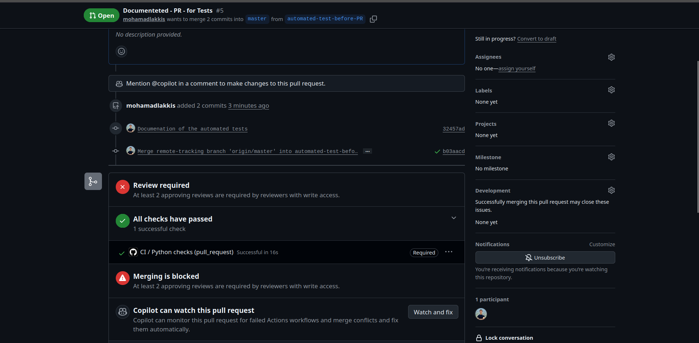

## Table of contents

- [High-Level Overview](#high-level-overview)
  - [Pre-requisites](#pre-requisites)
  - [Setup for Part 1 (Conversion)](#setup-for-part-1-conversion)
    - [Description of the conversion part](#description-of-the-conversion-part)
    - [Running the Conversion part](#running-the-conversion-part)
  - [Setup for Part 2 (Analysis)](#setup-for-part-2-analysis)
- [How to contribute](#how-to-contribute)

# High-Level Overview 
For this project we are going to use the Nasdaq ITCH data to do some analysis on it. We will later go into details on what exact hypothesis we are going to test and what analysis we are going to do, but for now we will focus on the data preparation part. So we have to focus on part 1 (Conversion) and part 2 (Analysis).

We needed a level-3-order book data to do our analysis, so we stumbled upon the Nasdaq ITCH data which contains the level-3-order book data for one day(December 30, 2019), and for multiple tickers. (Sneak peek: we will focus on AAPL ticker for now, but we can do the same for other tickers as well).
Now this data is in a binary format (.gz) which is not very easy to work with, so we need to convert it into a more structured format (parquet) which is easier to work with[THis is in a nutshell what we are going to do in part 1 (Conversion)]. And then we will do some analysis on this parquet file [This is part 2 (Analysis)].

## Pre-requisites
1. This project works on Ubuntu, Windows and Mac. Since each one of us has a different operating system. We wrote 1 setup script for each operating system, so you can run the corresponding setup script for your operating system. 
2.  uv must be installed (much faster than pip), you could simply download it using: 

    ```bash 
    pip install uv
    ```
    or check this https://docs.astral.sh/uv/getting-started/installation/

3. At least 4 GB of free disk (for the raw 3.52 GB and the parquet is 23.26 MB (since it contains only APPL ticker))


## Setup for Part 1 (Conversion)

### Description of the conversion part
The next couple of lines explains the high level flow of the code and why we made it this way. 

We have a messy binary file (.gz) which we need to convert into a more structured format (parquet). And then the analysis part we need to read this parquet file and do some analysis on it. But we need to ask ourselves how will we convert into this parquet file, I mean what data will we store and how (i.e. what schema will we use), because this also affect tha analysis part, because it is going to read this parquet file. And the good sofware design is to make a common schema which is going to be used by both the conversion and analysis part. 

```
book_reconstruction ->  common <- analysis 
```


The initial step is to run `bash setup_scripts/ubuntu_setup.sh` (or the corresponding script in `setup_scripts/` for your operating system) to download the raw data (.gz).

Next we need to convert this .gz into parquet file, it will convert the .gz into .parquet with default values and out paths and ticker is apple. WE can play around with this I made a cli arugments you can check this [book-reconstruction/README.md](book-reconstruction/README.md)

For more details the output for now will be in data/processed/AAPL_2019-12-30.parquet (if default values used). You can also check a detailed report in data/processed (it is a .json) file it contains useful descriptiove information on what we did just convert (how many values, and some other statistcics) NOTE: THis conversation included tests and checks, if something fails it will give you a report and return 1 instead of failing silently, it will also give you a diagnostic report which it will print its path. (These checks establish structural and selected-ticker replay consistency.)
(it will seem complex but it is not under the hood it is doing very simple things) check the [book-reconstruction/README.md](book-reconstruction/README.md) for a lot more details on this, it is really interesting. 


The common [common/SCHEMA.md](common/SCHEMA.md) shows us the schema this way you can directly start the analysis part without worrying about the conversion part[But of course you need to run the conversion part first to get the parquet file].

So direct next Steps: 

### Running the Conversion part
Run 

```
use `setup_scripts/ubuntu_setup.sh`, `setup_scripts/macos_setup.sh`, or `setup_scripts/windows_setup.ps1`
NOTE: The command and terminal to use are written at the top of the scripts.
```

Then run 

```
uv sync --locked (this will install all the dependencies in a virtual environment analogue to pip install -r requirements.txt , the --locked is to make sure we are using the exact same versions of the dependencies as the ones used by the developers)
```

Then run 

```
uv run itch-convert (this will convert the .gz into .parquet and also give you a report in data/processed, this itch-convert is defined in the pyproject.toml file)
```

For more details: 
Start with the [conversion guide](book-reconstruction/README.md), then the
[shared schema](common/SCHEMA.md) and [code walkthrough](docs/CODE_WALKTHROUGH.md).


## Setup for Part 2 (Analysis)
TODO


# How to contribute
For doing a PR to master branch, 3 automated checks must pass: 
  1. github workflow checks (pytest, ruff, mypy)
  2. Having the most latest version of the code (git pull origin master)
  3. 2 approvales from the reviewers must accept

Tips to contribute:
1. Before doing a PR you can run local automated checks to make sure your code is not breaking anything. (See below)
1.1. Pull the latest version of the code (git pull origin master)
1.2. Run the following commands to run the automated checks locally:

```bash
uv sync --locked --group dev
uv run --locked pytest -q
uv run --locked ruff check .
uv run --locked mypy
```

Example on what you will see in the github interface: 


