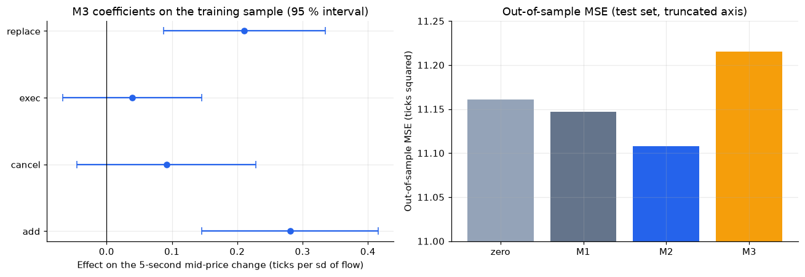
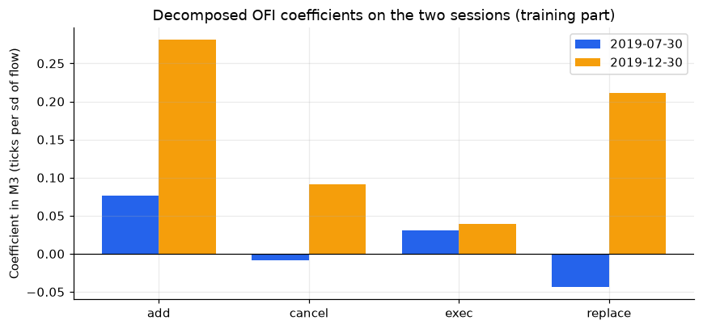

# Does order flow help predict short-term price moves? Evidence from the Nasdaq order book of AAPL

## 1. Question

A limit order book lists the buy and sell orders waiting to be executed. Every second, thousands
of orders are added, cancelled or executed. We ask whether this flow of orders helps to predict
how the price of Apple (AAPL) moves over the next 5 seconds, beyond what the current state of the
book already tells.

We test two hypotheses:

- **H1.** Adding the order flow of the last second to the state of the book improves the forecast.
- **H2.** Splitting this flow by type of order (added, cancelled, executed, replaced) improves it
  further.

## 2. Data

We use Nasdaq TotalView-ITCH 5.0 files, which record every message sent by the exchange, for every
order: this is "level 3" data, the most detailed public view of the book. Nasdaq publishes a few
sample days for free; one day is a compressed file of about 4 GB covering all stocks.

| Day | Messages kept for AAPL | Use |
|---|---|---|
| 2019-12-30 | 1,519,367 | main study (notebooks 01, 02, 03) |
| 2019-07-30 | 1,315,849 | second day, to check the results (notebook 04) |

Our converter (`book-reconstruction/`) reads the binary file, keeps the AAPL messages and writes
them to a Parquet file with a fixed schema (`common/SCHEMA.md`). It checks the file as it goes:
message sizes, time order, and the consistency of each order through its life (an order cannot be
cancelled before it was added, for example). The December file is shipped in `data/default/`.
For July 30 we only ship the one-second table used by the models (about 1 MB), so no download is
needed to rerun the analysis.

Notebook 01 describes the messages: their types, sizes and how activity changes during the day.

## 3. Method

**Rebuilding the book.** We replay the messages in order to know, after each one, the best bid
and ask prices and the number of shares at these prices. We keep regular trading hours and drop
the rare moments when the best bid is not below the best ask.

**One-second table.** From 09:35 to 15:55 we build one row per second (22,801 rows per day):

- *State of the book* at time t: the spread, the imbalance between the shares at the best bid
  and at the best ask, and the total number of shares at these two prices.
- *Order flow* during the last second: the order flow imbalance (OFI) of Cont, Kukanov and
  Stoikov (2014). It adds up the shares that push the price up (new buy orders, cancelled or
  executed sell orders at the best prices) minus those that push it down. For H2 we compute it
  separately for each message type, so that the four parts add up to the total.
- *Target*: the change of the mid-price (halfway between the best bid and ask) between t and
  t + 5 seconds, in ticks of one cent.

The features only use information up to t and the target only uses what happens after t.

**Models.** Three linear regressions, each one containing the previous one:

| Model | Features |
|---|---|
| M1 | state of the book (spread, imbalance, depth) |
| M2 | M1 + total OFI (H1) |
| M3 | M1 + OFI split into added, cancelled, executed and replaced orders (H2) |

We also report the simplest forecast, "the price does not move", as a reference.

**Evaluation.** Each model is fitted on the first 70 % of the day and evaluated on the last 30 %
(14:01 to 15:55), in time order. We drop the last 5 seconds of the training part, whose target
overlaps the test part, and we scale the features with the training part only. We compare the
models by their mean squared error (MSE) on the test part. To decide whether a larger model is
really better, we use the Clark-West test, which is designed for models that contain one another.
Since the 5-second changes of neighbouring seconds overlap, all standard errors are corrected for
this overlap (Newey-West). On the second day we also fit the models on one whole day and evaluate
them on the other.

## 4. Results

**Forecast errors on the test part of each day (MSE, ticks squared)**

| | Price does not move | M1 | M2 | M3 |
|---|---|---|---|---|
| 2019-12-30 | 11.161 | 11.147 | **11.108** | 11.216 |
| 2019-07-30 | 4.275 | 4.267 | 4.265 | **4.260** |

**Tests (one-sided p-values of the Clark-West test)**

| | H1: M2 better than M1 | H2: M3 better than M2 |
|---|---|---|
| 2019-12-30, within the day | < 0.001 | 0.67 |
| 2019-07-30, within the day | 0.09 | 0.01 |
| fitted on July, tested on December | < 0.001 | 0.44 |
| fitted on December, tested on July | 0.01 | 0.47 |

**H1 is supported.** The OFI improves the forecast on both days and when a model fitted on one day
is used on the other. In December, M2 also beats M1 in each of 5 successive test windows
(notebook 03). The size of the effect changes a lot: one standard deviation of OFI moves the
forecast by 0.29 tick in December but only 0.056 tick in July, a calmer day where the price moves
half as much. A model fitted in December therefore overstates the effect in July, and its MSE is
then worse than that of M1, even though the OFI still carries information. In practice, the model
has to be re-fitted on recent data. Forecasting the move in units of the recent volatility (the
standard deviation of the 5-second changes over the last 5 minutes) removes most of this problem:
the December models then do about as well as "the price does not move" in July, and the OFI stays
significant (notebook 04).

**H2 is not supported.** On December 30 the four parts of the flow have clearly different
coefficients on the training data, mostly added and replaced orders (figure 1), but M3 forecasts
worse than M2 on the test part, and better in only 2 of the 5 test windows. July shows the opposite
pattern. When a model is fitted on one day and used on the other, M3 is never better than M2.
The coefficients also change from one day to the next: added orders have the largest effect on
both days, but the effects of cancelled and replaced orders change sign (figure 2). Splitting the
flow adds three coefficients to estimate, and they do not carry over to another day. The total
OFI is as useful as its four parts.

Two extra checks give the same answer. A version of M3 whose four coefficients are pulled towards
each other (ridge regression) is as good as M2 in December (p = 0.17) and keeps the gain of M3 in
July. With the target scaled by the recent volatility, M3 beats M2 across days for some lengths of
the volatility window but not for others, so we do not count it as evidence.



*Figure 1. December 30. Left: coefficients of the four parts of the flow in M3, with 95 %
intervals. Right: MSE on the test part (the vertical axis does not start at zero).*



*Figure 2. Coefficients of the four parts of the flow in M3 on the two days.*

**Size of the gains.** All gains are small. The best model reduces the error of "the price does not
move" by less than 0.5 %, and the models fitted in December do worse than this forecast in July
unless the target is scaled by the volatility.
Five-second price moves are mostly noise; the flow explains a small but real part of them.

## 5. Limits

- **Two days.** Enough to see that the December results are not an accident, not enough to say
  how often each result happens. The days were not drawn at random: Nasdaq only publishes a few
  of them, and Apple published its quarterly results on July 30 (after the close).
- **Few independent observations.** Each test part has 6,841 seconds, but the 5-second changes of
  two neighbouring seconds share 4 seconds, so the tests can only detect fairly large gains.
- **Narrow scope.** One stock, one horizon, and only the orders at the best bid and ask. Orders
  deeper in the book and hidden orders are not counted.
- **Choices.** A replaced order is kept as its own group instead of a cancellation plus a new
  order. The models with a single group or with one group removed (notebook 03) were added after
  the main results and are only exploratory. The same holds for the ridge version of M3 and the
  scaled target, added after a review.
- **No trading strategy.** We measure forecast errors, not profits, and ignore trading costs.

## 6. Reproducing the results

```bash
uv sync --locked          # install the pinned dependencies
uv run itch-convert       # optional: rebuild data/processed/AAPL_2019-12-30.parquet from the raw file
```

Then open the notebooks in `analysis/` with the project's `.venv` kernel:

| Notebook | Content |
|---|---|
| `01_event_descriptive_analysis.ipynb` | description of the messages |
| `02_mid_price_prediction.ipynb` | H1 on December 30 |
| `03_hypothesis2_decomposed_flow.ipynb` | H2 on December 30 |
| `04_second_day_replication.ipynb` | H1 and H2 on July 30, and across the two days |

Notebooks 03 and 04 share their code in `analysis/flow_study.py`. Notebook 03 checks that it gives
exactly the results of notebook 02.

**Reference.** R. Cont, A. Kukanov and S. Stoikov (2014), "The price impact of order book events",
*Journal of Financial Econometrics* 12(1), 47-88.
