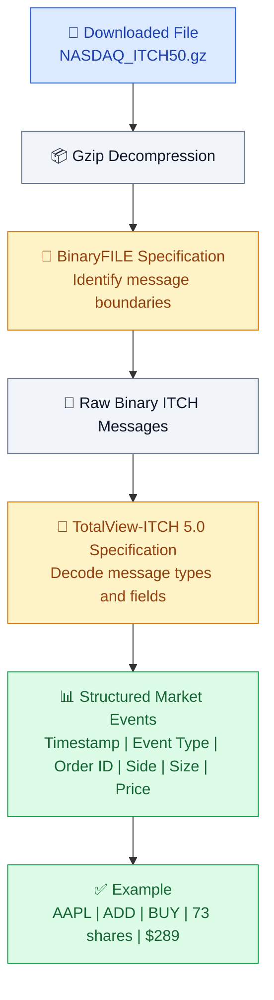

## How the current repo is structured
The current repo is structured as follows:
We have the market-making folder that contains a script called inspect_nasdaq_itch.py that will read the raw data and print the first 30 messages for a given symbol. [NOTE: RUN THE SCRIPT AFTER THE INTIAL SETUP, see below for more details]

## Intial Setup 
Since I am on ubuntu, I created a bash script called ubuntu_setup.sh [For your OS ask claude for help, it is a simple 3 line setup]
This script will download the following data (which is kept it in .gz) 
We are using NASDAQ Level-3 (TotalView-ITCH 5.0) data from Monday, December 30, 2019. 

If you are looking at this webiste: https://emi.nasdaq.com/ITCH/Nasdaq%20ITCH/
it is essentially this file: 12302019.NASDAQ_ITCH50.gz
[It is big but not huge compared to other days, it is 3.52 GB, make sure you are not on 5g LOL]
[NOTE: this is the compressed file, and no need to decompress it, the script will read this file directly using gzip library this way we do not need to decompress it and save it on disk, which is a waste of space(but python will decompress it in memory and read it directly)]

[IN ANY CASE the long term goal is to process them using parquet files, but now we are still inexperimenation phase and playing around with the raw data, so we will use the raw data directly]

## BinaryFile (How to read the raw data)
The pdf [binaryfile.pdf](./NASDAQ_GUIDE_PDF/binaryfile.pdf) is a binary file that show us how to read the raw(.gz) data, 
The first two bytes tell the parser how many bytes to read for the next message.
Example: [00 24] [Message data: 36 bytes] -> 00 24 represents 36 in hexadecimal
NOTE: This PDF does not tell you what a buy order, cancellation, or execution means. It only explains how to locate individual messages in the binary stream.

## NASDAQ TOTALVIEW-ITCH 5.0 Specification 
The pdf [totalview-itch-5.0.pdf](./NASDAQ_GUIDE_PDF/totalview-itch-5.0.pdf) is a specification that explains what each message means and how to interpret the data within each message.
This document explains that after decoding the binary data, you will have a series of messages. The document explains what each message means and how to interpret the data within each message.

## NASDAQ TotalView-ITCH 5.0 Data Processing Pipeline [I am not that good in mermain, this was generated using CHATGPT]

## RUnning the script to inspect the data structure
Now once you run the 
python3 inspect_nasdaq_itch.py \
        data/raw/12302019.NASDAQ_ITCH50.gz \
        --symbol AAPL \
        --limit 30

You will get something like this: [Check the pdf age 13 for more details about the notations]

241882,04:00:00.007075802,A,ADD,11825,S,16,299.9000,16,,

| Column | Value | Explanation |
|---|---|---|
| `sequence` | 241882 | Position of this message in the file, counting all stocks(NOT JUST AAPL) |
| `time` | 04:00:00.007075802 | Exchange timestamp [US eastern Time] the 007075802 nano seconds |
| `type` | A | NASDAQ ITCH message type |
| `event` | ADD | I added this to indicate that A represents an add message |
| `order_id` | 11825 | Unique reference identifying this particular order(Maybe leter they delete it) |
| `side` | S | limit order type  (B or S) [THIS IS DIFFERENT THAN AGGRESSIVE BUY OR SELL!!!!] |
| `quantity` | 16 | 16 shares affected by this event[we have different interpretations for each TYPE  check the table directly below this one] |
| `price` | 299.9000 | Limit price of $299.90 per share[THIS IS NOT THE CURRENT MID-PRICE it is what the order was placed at]  |
| `remaining_quantity` | 16 | All 16 shares are still resting in the order |
| `aggressor` | Empty | [E or C] for aggressive trades |
| `notes` | Empty | Additional diagnostic information from our parser |

### Interpretation of the quantity field depends on the message type. 

| Message | Quantity means |
|---|---|
| ADD | Shares added |
| PARTIAL_CANCEL | Shares removed through cancellation |
| DELETE | Remaining shares removed |
| EXECUTION | Shares executed |
| REPLACE | Quantity of the replacement order |

### Examples: 
| # | Time | Order ID | Event | What happened |
|---|---|---|---|---|
| 1 | 04:00:00 | 11825 | ADD | Someone offered to **sell 16 AAPL shares at $299.90**. |
| 2 | 04:00:02 | 74473 | ADD | Someone submitted a **buy limit order for 73 shares at $289.00**. |
| 3 | 04:00:09 | 104861 | ADD | A buy limit order for 100 shares was submitted at $249.82. |
| 4 | 04:00:10 | 105925 | ADD | A buy limit order for 80 shares was submitted at $263.70. |
| 5 | 04:00:19 | 110017 | ADD | A buy limit order for 30 shares was submitted at $289.01. |
| 6 | 04:00:19 | 110021 | ADD | A buy limit order for 30 shares was submitted at $288.96. |
| 7 | 04:00:19 | 110025 | ADD | A sell limit order for 30 shares was submitted at $299.94. |
| 8 | 04:00:19 | 110029 | ADD | A sell limit order for 30 shares was submitted at $299.89. |
| 9 | 04:00:20 | 110533 | ADD | A sell limit order for 4 shares was submitted at $300.00. |
| 10 | 04:00:22 | 110837 | ADD | A sell limit order for 10 shares was submitted at $300.00. |
| 11 | 04:00:33 | 112577 | ADD | A sell limit order for 15 shares was submitted at $291.00. |
| 12 | 04:00:33 | 110029 | DELETE | The previously submitted **30-share sell order at $299.89 was cancelled entirely**. |
| 13 | 04:00:33 | 110025 | DELETE | The previously submitted **30-share sell order at $299.94 was cancelled entirely**. |
| 14 | 04:00:33 | 112605 | ADD | A new sell limit order for 30 shares was submitted at $290.99. |
| 15 | 04:00:33 | 112609 | ADD | A new sell limit order for 30 shares was submitted at $291.04. |
| 16 | 04:00:33 | 112669 | ADD | A sell limit order for 1 share was submitted at $294.23. |
| 17 | 04:00:34 | 112681 | ADD | A buy limit order for 1 share was submitted at $216.26. |
| 18 | 04:00:34 | 112685 | ADD | A sell limit order for 1 share was submitted at $298.02. |

Notice events 8 and 12:

#### Event 8
ADD order 110029
Side: SELL
Quantity: 30
Price: $299.89
Remaining: 30

#### Event 12: 
DELETE order 110029
Side: SELL
Quantity: 30
Price: $299.89
Remaining: 0

#### What happened here?
At 04:00:19, 30 shares were offered for sale.

At 04:00:33, the order was cancelled.

No execution is recorded against that order in between.

Therefore, those shares were withdrawn from the book rather than consumed through a trade.

This is exactly the distinction LPI/LCI research needs.

## Next Steps: 
Check the following link for more details about the data and how to process it: [TODO.md](./TODO.md)
